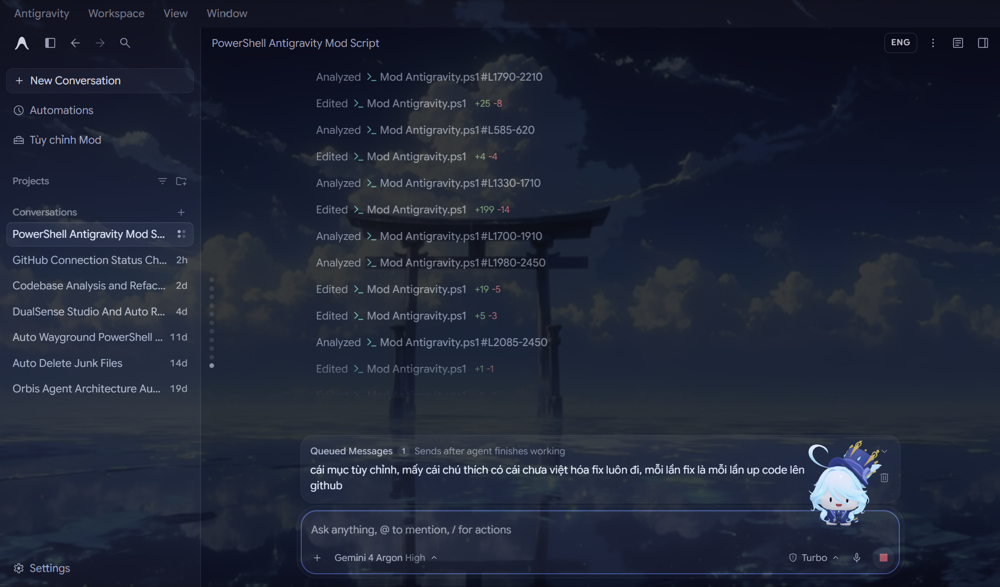

# 💧 Antigravity Mod (Furina 3D Edition)

[](./LICENSE)
[](https://github.com/siloneedsleep/antigravity-mod)
[](https://github.com/siloneedsleep/antigravity-mod)

Bộ công cụ tùy biến giao diện (**UI Mod & Vietnamese Localization**) dành cho **Google Antigravity 2.0**, tích hợp nhân vật đồng hành **3D Chibi Furina (WebGL / Three.js)** ngồi trực tiếp trên khung chat với hiệu ứng nghiêng đầu & xoay người nhìn theo từng chữ bạn đang gõ theo thời gian thực.

<p align="center">
  
</p>



---

## ✨ Tính năng nổi bật

### 1. 🧊 Nhân vật đồng hành 3D Chibi Furina (Real-time WebGL)
- **Render 3D trực tiếp bằng Three.js (`FBXLoader`)**: Tải model 3D `furi.fbx` cùng 5 lớp texture sRGB nguyên bản (`ROP`, `ACCE`, `CABELLO`, `SOMBRE_2`, `TOONIX`) ngay phía trên khung nhập chat (`.surface-composer-card`).
- **Nhìn theo chữ khi đang chat (Eye & Caret Tracking)**: Tự động tính toán tọa độ con trỏ văn bản (`Selection` / `Range.getClientRects()`) để xoay đầu/thân 3D (`Yaw`, `Pitch`, `Roll`) và di chuyển nhẹ dọc theo thanh chat theo từng ký tự bạn gõ.
- **Tương tác vật lý theo phím bấm**:
  - **Khi gõ phím**: Nhún nhảy theo hệ vật lý lò xo (Spring Physics), lắc lư nhẹ và thả hạt nguyên tố Thủy (`💧`, `♪`, `✦`, `🫧`).
  - **Khi nhấn `Enter` gửi tin nhắn**: Nhảy cao và xoay 360° ăn mừng.
  - **Khi nhấn vào Furina**: Xoay vòng vui vẻ và hiển thị bong bóng thoại ngẫu nhiên.
  - **Trạng thái nghỉ (Idle)**: Thở nhẹ, đung đưa và chớp mắt 3D tự nhiên mỗi 3.6 giây.
- **Chế độ dự phòng 2D SVG & Custom PNG/GIF**: Hỗ trợ chuyển đổi tức thì giữa **Furina 3D Chibi**, **Furina 2D Chibi (SVG)**, **Fox**, **Cat**, **Panda**, hoặc bất kỳ link ảnh PNG/GIF tùy chỉnh nào.

### 2. 🇻🇳 Việt hóa toàn diện giao diện Antigravity 2.0
- Dịch thuật đầy đủ toàn bộ giao diện ứng dụng:
  - Thanh bên (Sidebar), Menu ngữ cảnh, Khung trò chuyện, Trạng thái suy nghĩ/thực thi của Agent (`Đã suy nghĩ ...`, `Đã xử lý ...`).
  - Kho tiện ích (**Marketplace / Customizations**) và **Tự động hóa (Automations)**.
  - Toàn bộ các tab trong **Cài đặt (`Settings`)**: *Chung*, *Ứng dụng*, *Giao diện*, *Phím tắt*, *Thông báo*, *Mô hình AI & Mức dùng*, *Dự án* và hộp thoại *Gửi phản hồi*.
- **Bảo toàn 100% văn bản gốc**: Lưu trữ văn bản tiếng Anh gốc trên từng DOM Text Node (`node.__agOrigText`), cho phép chuyển đổi qua lại giữa **Tiếng Việt (`VI`)** và **Tiếng Anh (`ENG`)** mượt mà kèm hiệu ứng chuyển cảnh mờ (`backdrop-filter: blur`).

### 3. ⚙️ Tích hợp trực tiếp vào Cài đặt (`✨ Antigravity Mod`, `☕ Donate`, `👑 Credit: Silo`) & Phím tắt nhanh
- **Mục riêng trong Cài đặt**: Tự động thêm tab `✨ Antigravity Mod` cùng 2 mục `☕ Donate (VietQR)` và `👑 Credit: Silo` (nằm ngay phía trên mục *Gửi phản hồi*) vào thanh bên của cửa sổ **Cài đặt (`Settings`)** gốc của Antigravity.
- **Cổng Thanh Toán / Donate Tự Động VietQR (Shop Style)**: Tích hợp ngay trong `Cài đặt -> ☕ Donate (VietQR)`, cho phép chọn các gói mệnh giá hoặc tự nhập số tiền tùy tâm, tự động sinh mã đơn hàng (`#ORD-xxxxxx`), nội dung chuyển khoản (`SILOxxxxxx`), đồng hồ đếm ngược 15 phút và mã **VietQR Napas 247** chuẩn xác.
- **Menu mở nhanh (`Alt + M`)**: Bấm `Alt + M` ở bất kỳ đâu để bật/tắt nhanh bảng điều khiển Mod (hoặc nhấn `Esc` để đóng).
- **Đổi ngôn ngữ nhanh (`Alt + L`)**: Bấm `Alt + L` hoặc nút `[VI / ENG]` trong suốt nằm cân đối trên thanh điều hướng trên cùng.
- **Tùy chỉnh hình nền & màu chủ đạo**: Chọn nhanh các mẫu hình nền (*Rừng Đêm*, *Nhà Hát Fontaine*, *Cyberpunk Neon*, *Vũ Trụ Tinh Vân*, *Sương Mù Núi* hoặc URL bất kỳ), điều chỉnh thanh trượt độ mờ (`Opacity`) và bộ chọn màu viền chủ đạo (`Accent Color`).

---

## ⌨️ Phím tắt

| Phím tắt | Chức năng |
| :--- | :--- |
| **`Alt + M`** | Mở / Đóng nhanh bảng điều khiển **Antigravity Mod** |
| **`Alt + L`** | Chuyển đổi nhanh ngôn ngữ **Tiếng Việt (`VI`) ↔ Tiếng Anh (`ENG`)** |
| **`Esc`** | Đóng nhanh bảng điều khiển Mod |

---

## 🚀 Hướng dẫn cài đặt

### Cách 1: Chạy trực tiếp bằng PowerShell (Khuyên dùng)

1. Tải repository về máy hoặc tải trực tiếp file [`Mod Antigravity.ps1`](./Mod%20Antigravity.ps1):
   ```powershell
   git clone https://github.com/siloneedsleep/antigravity-mod.git
   cd antigravity-mod
   ```
2. Chạy script bằng PowerShell:
   ```powershell
   powershell -NoProfile -ExecutionPolicy Bypass -File ".\Mod Antigravity.ps1"
   ```

### Cơ chế hoạt động kép (Dual-Mode Patching)
- **Live CDP Injection (Không cần khởi động lại)**: Nếu Antigravity đang mở, script tự động đọc cổng gỡ lỗi từ `%APPDATA%\Antigravity\DevToolsActivePort` và tiêm trực tiếp bản Mod vào cửa sổ đang chạy ngay lập tức.
- **Persistent ASAR Patching (Lưu vĩnh viễn)**: Tự động sao lưu `resources\app.asar.bak` và `Antigravity.exe.bak`, sau đó đóng gói bản Mod vào `dist/preload.js` trong `resources\app.asar` và cập nhật lại bảng băm SHA-256 để giữ nguyên bản Mod cho mọi lần khởi động sau.

---

## 📁 Cấu trúc thư mục

```text
antigravity-mod/
├── Mod Antigravity.ps1           # Script cài đặt & tiêm trực tiếp All-in-One (PowerShell)
├── src/
│   ├── styles.css                # Toàn bộ CSS giao diện, hiệu ứng mờ, 3D/2D companion & modal
│   └── mod.js                    # Nhân xử lý Three.js 3D Furina, Caret Tracking & bộ dịch DOM i18n
├── assets/
│   ├── furina-3d-preview.png     # Ảnh render model 3D Chibi Furina
│   ├── ui-preview.png            # Ảnh chụp giao diện thực tế trên Antigravity 2.0
│   └── furina-3d/                # Tài nguyên model 3D FBX & 6 texture sRGB gốc
│       ├── furi.fbx
│       ├── ACCE_BaseColor_sRGB.1001.png
│       ├── CABELLO_BaseColor_sRGB.1001.png
│       ├── ROP_BaseColor_sRGB.1001.png
│       ├── SOMBRE_2_BaseColor_sRGB.1001.png
│       ├── TOONIX.002_BaseColor_sRGB.1001.png
│       └── furiba.png
├── LICENSE                       # Giấy phép nguồn mở MIT
└── README.md                     # Tài liệu hướng dẫn chi tiết
```

---

## 👑 Credit & Tác giả (Author)

Dự án được thiết kế, phát triển và duy trì bởi **Silo (Đỗ Trường Thịnh)**:

- **Tác giả (Creator & Maintainer)**: **Silo** — **Đỗ Trường Thịnh** ([@siloneedsleep](https://github.com/siloneedsleep))
- **Kho lưu trữ (GitHub Repo)**: [https://github.com/siloneedsleep/antigravity-mod](https://github.com/siloneedsleep/antigravity-mod)
- **Portfolio**: [https://github.com/siloneedsleep/portfolio](https://github.com/siloneedsleep/portfolio)

---

## ☕ Ủng hộ tác giả / Donate (VietQR Napas 247)

Nếu bạn thấy bản Mod hữu ích, bạn có thể ủng hộ **Silo** trực tiếp ngay trong mục **`Cài đặt (Settings) -> ☕ Donate (VietQR)`** của ứng dụng (hệ thống tạo đơn & mã QR tự động như Shop, tùy tâm chọn mệnh giá hoặc tự nhập số tiền), hoặc quét mã **VietQR** dưới đây:

- **Ngân hàng**: **TPBank (Ngân hàng TMCP Tiên Phong)**
- **Số tài khoản (STK)**: `74486568888`
- **Chủ tài khoản**: `DO TRUONG THINH`
- **Nội dung chuyển khoản**: `SILO DONATE`

<p align="center">
  
</p>

---

## 📄 Giấy phép (License)

Dự án được phân phối dưới giấy phép **[MIT License](./LICENSE)** — Copyright (c) 2026 **Silo — Đỗ Trường Thịnh ([@siloneedsleep](https://github.com/siloneedsleep))**.
